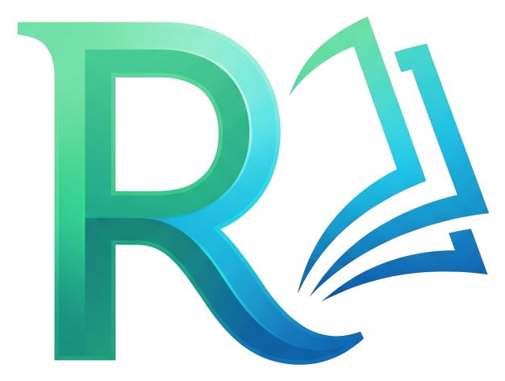
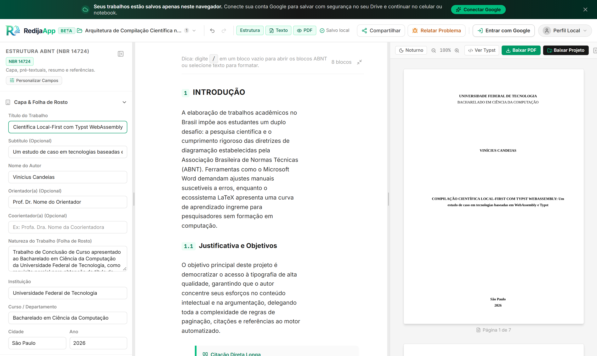
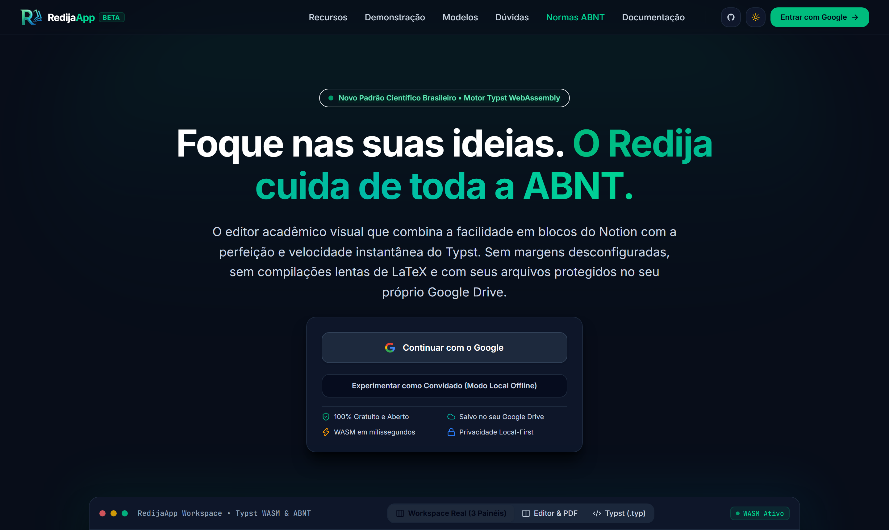
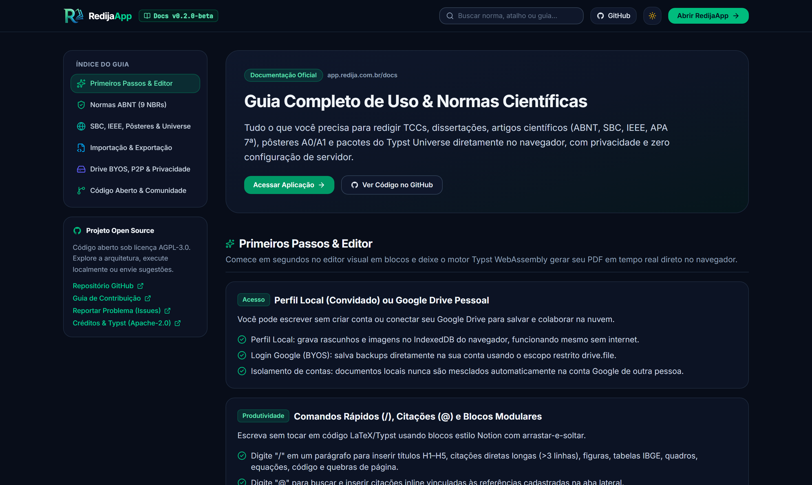

<p align="center">
  <a href="https://app.redija.com.br">
    
  </a>
</p>

<h1 align="center">RedijaApp</h1>

<p align="center">
  <strong>Editor acadêmico visual estilo Notion com compilação científica em tempo real no navegador via Typst WebAssembly.</strong>
</p>

<p align="center">
  <a href="https://app.redija.com.br"><strong>Acessar Aplicação</strong></a> •
  <a href="https://app.redija.com.br/docs"><strong>Documentação</strong></a> •
  <a href="CONTRIBUTING.md"><strong>Contribuir</strong></a> •
  <a href="https://github.com/project-rev/redija-app/issues"><strong>Issues</strong></a>
</p>

<p align="center">
  
  <a href="https://github.com/project-rev/redija-app/actions/workflows/ci.yml"></a>
  
  
  
  <a href="LICENSE"></a>
</p>

---

## Sobre o Projeto

O **RedijaApp** combina uma interface visual em blocos (estilo Notion, baseada em TipTap) com o motor tipográfico **Typst compilado em WebAssembly** executando integralmente no navegador — eliminando a formatação manual frágil do Word e a curva de configuração de servidores LaTeX.

> 📖 **Documentação de Uso e Normas:** Consulte **[app.redija.com.br/docs](https://app.redija.com.br/docs)** para guias detalhados sobre normas ABNT (9 NBRs), SBC, IEEE, APA 7ª Edição, Pôsteres A0/A1, Typst Universe, atalhos `/` e `@`, importadores (`.docx`, `.tex`, `.md`, `.typ`, `.zip` do Overleaf/Typst e `.redija`), Google Drive BYOS e colaboração P2P.

---

## Novidades da versão 0.5.0-beta

- **Nova tela inicial:** substitui a lista de projetos em modal. Traz o cartão "Continuar de onde parou", os trabalhos em grade ou lista com capas ilustradas, ações rápidas (abrir, baixar PDF, duplicar, renomear, mover para a Lixeira) e busca com Ctrl/⌘K. O endereço `/` abre a tela inicial e `/?p=<id>` abre o trabalho direto no editor.
- **Modelos do Typst Universe na tela inicial:** "Mais modelos" mostra todos os modelos sem sair da tela, e "Buscar novos modelos" explica o Typst Universe, valida o pacote e o guarda em "Seus modelos", neste navegador e por perfil.
- **Painéis mais flexíveis:** abaixo de 1280 px, Estrutura, Texto e PDF viram abas. Cada painel pode ser maximizado, minimizado (vira uma barra lateral) e restaurado, e as larguras acompanham o tamanho da janela.
- **Cabeçalho e barra do PDF mais enxutos:** "Relatar problema ou sugestão" passa para o menu do perfil, o login segue o padrão do Google ("Conectar") e a barra do PDF fica só com ícones. "Baixar" oferece PDF, projeto completo (`.zip`) e código Typst (`.typ`).
- **Acessibilidade:** modais com foco preso e Esc, contraste AA, alvos de toque de 44 px, divisores ajustáveis pelo teclado, mover blocos com Ctrl+Shift+↑/↓ e respeito a `prefers-reduced-motion` e ao tema do sistema, sem piscar ao abrir.
- **Menos interrupções:** avisos e confirmações em dois passos no lugar de `alert()`/`confirm()`, e o tema claro ganhou a mesma hierarquia de tons do escuro.

<details>
<summary>Novidades da versão 0.4.0-beta</summary>

- **Layout responsivo:** a partir de 1024 px, Estrutura, Texto e PDF ficam lado a lado com larguras ajustáveis. Em telas menores, um painel por vez, alternado por abas. Cabeçalho, modais, editor, preview e landing também foram ajustados para celular.
- **Importação só via Pandoc:** `.docx`, `.tex`, `.md`, `.typ` e `.zip` (Overleaf/Typst) passam apenas pelo serviço de conversão ([`server/`](server/README.md)). Os importadores antigos por regex foram removidos; sem o serviço, o app mostra uma mensagem clara. Arquivos `.redija` e `.zip` exportados pelo Redija continuam sendo importados localmente.
- **Arquivos maiores na importação:** upload de até 250 MB (600 MB descompactado), imagens de até 50 MB cada e cota de imagens por projeto de 250 MB.
- **Nova casa no GitHub:** o repositório agora é [`project-rev/redija-app`](https://github.com/project-rev/redija-app), com template de PR, fluxo de branches documentado no [CONTRIBUTING](CONTRIBUTING.md) e um [Project](https://github.com/orgs/project-rev/projects/2) com o roadmap em épicos e histórias.

</details>

<details>
<summary>Novidades da versão 0.3.0-beta</summary>

- **Importação via Pandoc:** novo serviço de conversão ([`server/`](server/README.md)) que transforma `.docx`, `.tex`, `.md`, `.typ` e `.zip` (Overleaf/Typst) em projetos `.redija`, preservando títulos, listas, tabelas/quadros, figuras com legenda e fonte ABNT, notas, equações, resumo/abstract e referências do `.bib`. Projetos LaTeX reais (abnTeX2 e modelos institucionais) agora são importados corretamente.
- **Normas atualizadas:** ABNT **NBR 10520:2023** (citações) e **NBR 6028:2021** (resumos), com avisos contextuais no Customizer quando uma alteração foge da norma.
- **Figuras com até 4 imagens:** um único bloco de figura agrupa até quatro imagens (em linha, grade 2×2 ou empilhadas), com legenda e fonte compartilhadas.
- **Norma & Layout simplificado:** abas do Customizer reorganizadas e com menos opções redundantes.
- **Equações no PDF:** a fonte matemática *New Computer Modern Math* agora vem embutida, então blocos de equação e matemática inline compilam no WASM.
- **Lixeira sincronizada com o Google Drive:** mover um projeto para a Lixeira também o envia para a lixeira do Drive; restaurar e excluir de vez são refletidos lá e em outros dispositivos.
- **Release automático:** cada merge na `main` cria a tag e a Release no GitHub a partir da versão do `package.json`.

</details>

---

## Capturas de Tela

### Editor Visual em Blocos + Compilação Typst WASM em Tempo Real


<details>
<summary>Ver mais telas (Landing Page & Central de Documentação integrada)</summary>

#### Página Inicial (Dark Mode)


#### Central de Documentação (`/docs`)


</details>

---

## Arquitetura & Stack

O projeto adota processamento *local-first* e separação clara entre thread de interface, motor WASM e regras de domínio:

- **Worker WASM Dedicado (`src/core/typst/typst.worker.ts`):** compilador e renderizador Typst operam fora da *main thread*, rasterizando páginas em `OffscreenCanvas` e transferindo `ImageBitmap` *zero-copy* para o preview.
- **Transpilador & Verificadores Plurais (`src/core/transpiler/`):** gera código `.typ` multi-normas e valida regras via estratégias desacopladas (`linters/`).
- **Persistência & Importadores (`src/core/storage/`):** IndexedDB (Dexie.js) com lixeira de 30 dias sincronizada com a lixeira do Google Drive, sincronização BYOS via Google Drive v3 API e *Auto-Merge* não destrutivo. A importação usa o mapper `importer/pandoc/astToProject.ts` (AST do Pandoc → `.redija`). Só `.redija` e `.zip` exportados pelo Redija são lidos localmente (`importer/redijaZip.ts`).
- **Serviço de Importação (`server/`):** API Node ([Hono](https://hono.dev)) + Pandoc 3.6 empacotada em Docker e publicada no Railway. Não guarda arquivos e tem limites de upload, proteção contra *zip bomb*/*zip slip*, CORS restrito e *rate limit*. Infraestrutura descrita como código em [`.railway/railway.ts`](.railway/railway.ts).
- **Layout Responsivo (`src/hooks/usePaneLayout.ts`):** em telas a partir de 1280px, Estrutura, Texto e PDF ficam lado a lado, com larguras proporcionais à janela e cada painel podendo ser maximizado ou minimizado. Em telas menores, um painel por vez, alternado por abas.
- **Colaboração P2P (`src/core/collaboration/`):** troca de diffs e presença em blocos via WebRTC (PeerJS) e BroadcastChannel, sem banco de dados central.
- **Feedback Serverless (`api/feedback.ts`):** endpoint Vercel compatível com Resend estruturado via injeção de dependência (`EmailProvider`).

| Camada | Tecnologias |
| :--- | :--- |
| **Interface & Editor** | React 19, Tailwind CSS v4, TipTap 3, Lucide Icons |
| **Motor Tipográfico** | Typst WASM (`typst-ts ^0.7.0`: `typst-ts-web-compiler` + `typst-ts-renderer`) |
| **Linguagem & Build** | TypeScript 6.0, Vite 8 |
| **Armazenamento & P2P** | Dexie 4 (IndexedDB), Google Identity Services / Drive API, PeerJS, JSZip |
| **Importação (servidor)** | Node 24, Hono 4, Pandoc 3.6, Docker, Railway (Infrastructure as Code) |
| **Qualidade & Testes** | ESLint 10 (`--max-warnings 0`), Prettier 3, Vitest 5, Playwright Chromium |

### Estrutura de Diretórios

```text
redija-app/
├── .railway/               # Infraestrutura do Railway como código (serviço de importação)
├── api/                    # Serverless Function Vercel (/api/feedback)
├── docs/                   # Capturas de tela e ativos de documentação do repositório
├── e2e/                    # Testes End-to-End com Playwright
├── public/                 # Logo, favicon, fontes locais (Tinos, Arimo, New Computer Modern Math) e CNAME
├── server/                 # Serviço de importação (Pandoc → AST JSON), deploy no Railway
├── src/
│   ├── components/         # UI React (editor/, sidebar/, customizer/, landing/, docs/)
│   ├── core/               # Lógica de domínio (auth, collaboration, docs, feedback, storage, templates, transpiler, typst, universe)
│   ├── hooks/              # Hooks de estado e orquestração (workspace, undo/redo, drive sync, collab, rota)
│   ├── types/              # Contratos TypeScript de documentos, metadados e normas
│   └── App.tsx             # Orquestrador principal e roteamento
├── .github/workflows/      # CI & Guardrails (ci.yml)
├── vercel.json             # Headers CSP/WASM e rewrite SPA
└── vite.config.ts          # Configuração Vite 8 + worker ES
```

---

## Executando Localmente

### Pré-requisitos

- **Node.js** `20.19+`, `22.12+` ou `24 LTS`
- **npm**

### Instalação e Execução

```bash
git clone https://github.com/project-rev/redija-app.git
cd redija-app
npm install
cp .env.example .env
npm run dev
```

Acesse **`http://localhost:3000`** no navegador.

> **Nota:** Não é necessário configurar credenciais OAuth do Google para desenvolver localmente — na tela inicial, utilize **"Experimentar como Convidado"** ou **"Entrar como Usuário Demonstração"**.

### Serviço de Importação (opcional)

Para testar a importação via Pandoc localmente, rode o serviço em outro terminal (requer Node `22.18+` e o [Pandoc](https://pandoc.org/installing.html) no PATH, ou use o Docker) e defina `VITE_IMPORT_API_URL=http://localhost:8080` no `.env`:

```bash
cd server
npm install
npm start
```

Detalhes de endpoints, Docker e deploy em [`server/README.md`](server/README.md).

### Variáveis de Ambiente

| Variável | Obrigatória? | Finalidade |
| :--- | :---: | :--- |
| `VITE_GOOGLE_CLIENT_ID` | Opcional | Client ID OAuth 2.0 (Google Cloud Console) para habilitar login e sync real com Google Drive. |
| `VITE_IMPORT_API_URL` | Opcional | URL do serviço de importação (ex.: `http://localhost:8080`). Sem ela, só `.redija` e `.zip` exportados pelo Redija podem ser importados; os demais formatos mostram uma mensagem de serviço indisponível. |
| `RESEND_API_KEY` | Opcional *(prod)* | Chave do Resend usada pela Vercel Serverless Function em `/api/feedback`. |
| `RESEND_FROM_EMAIL` | Opcional *(prod)* | Remetente configurado no serviço Resend. |
| `RESEND_TO_EMAIL` | Opcional *(prod)* | Caixa de destino para relatos de bug/contato (padrão: `contato.redija@gmail.com`). |

### Scripts Disponíveis

| Comando | Descrição |
| :--- | :--- |
| `npm run dev` | Inicia o servidor de desenvolvimento Vite na porta `3000`. |
| `npm run typecheck` | Executa verificação estrita de tipos (`tsc --noEmit`). |
| `npm run lint` | Roda ESLint exigindo zero warnings (`--max-warnings 0`). |
| `npm test` | Executa todos os testes unitários e compilação WASM via Vitest. |
| `npm run test:e2e` | Executa a suíte End-to-End no Chromium via Playwright. |
| `npm run build` | Valida tipos e gera o bundle de produção em `dist/`. |
| `npm run format` | Formata o código com Prettier. |

---

## CI & Infraestrutura

- **Hospedagem (`https://app.redija.com.br`):** configurada para **Vercel** via [`vercel.json`](vercel.json) (com suporte a rewrites SPA para `/docs`, cabeçalhos CSP/WASM e função serverless `/api/feedback`) e compatível com **Netlify** via [`netlify.toml`](netlify.toml).
- **Serviço de Importação:** hospedado no **Railway** em dois ambientes, `production` (`main`, `api.redija.com.br`) e `dev` (`develop`, `api-dev.redija.com.br`), definidos em [`.railway/railway.ts`](.railway/railway.ts). O CSP de `vercel.json` e `netlify.toml` libera apenas esses domínios.
- **Pipeline Contínua ([`.github/workflows/ci.yml`](.github/workflows/ci.yml)):** executa `lint`, `typecheck`, `vitest`, `playwright` e `build` em pushes e PRs para `develop` e `main`, além de conter uma trava de segurança que bloqueia Pull Requests para `main` fora da branch `develop`.
- **Releases:** a cada merge na `main`, o CI cria a tag `vX.Y.Z` e a Release no GitHub (marcada como *pre-release* quando a versão tem sufixo, como `-beta`) a partir de `package.json`. Para lançar uma nova versão, atualize `version` em `package.json` e em `src/core/version.ts`.

---

## Contribuindo

Contribuições são muito bem-vindas! Antes de abrir um Pull Request:

1. Leia o guia completo em **[`CONTRIBUTING.md`](CONTRIBUTING.md)**.
2. Crie sua branch a partir da **`main`** e abra o PR para **`develop`** (PRs diretos para `main` são restritos).
3. Rode `npm run lint`, `npm run typecheck`, `npm test`, `npm run test:e2e` e `npm run build` antes de submeter.

---

## Licença & Créditos

- **Licença do Projeto:** distribuído sob a **GNU Affero General Public License v3.0 (`AGPL-3.0`)** — veja [`LICENSE`](LICENSE). Qualquer versão modificada executada em rede (SaaS) deve manter o código-fonte acessível sob os mesmos termos.
- **Marca e Identidade Visual:** a licença `AGPL-3.0` aplica-se exclusivamente ao código-fonte e não autoriza o uso do nome **RedijaApp** nem do logotipo oficial ([`public/logo.png`](public/logo.png)) em instâncias hospedadas por terceiros.
- **Créditos de Terceiros ([`THIRD_PARTY_NOTICES.md`](THIRD_PARTY_NOTICES.md)):** a compilação científica no navegador utiliza o motor [**Typst**](https://github.com/typst/typst) e os bindings WebAssembly [**`typst.ts`**](https://github.com/Myriad-Dreamin/typst.ts) (ambos sob licença **`Apache-2.0`**), além das fontes tipográficas e bibliotecas open source listadas nos avisos de terceiros.
