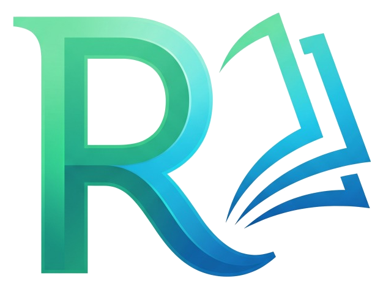
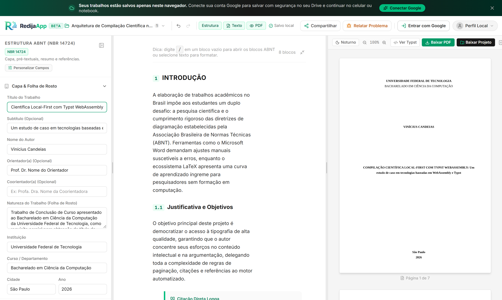
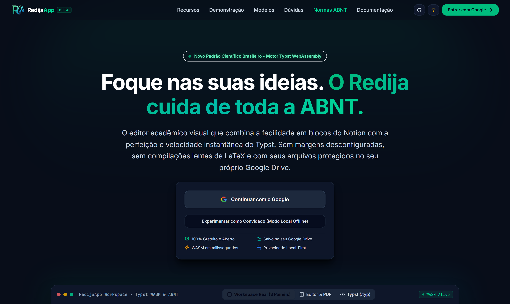
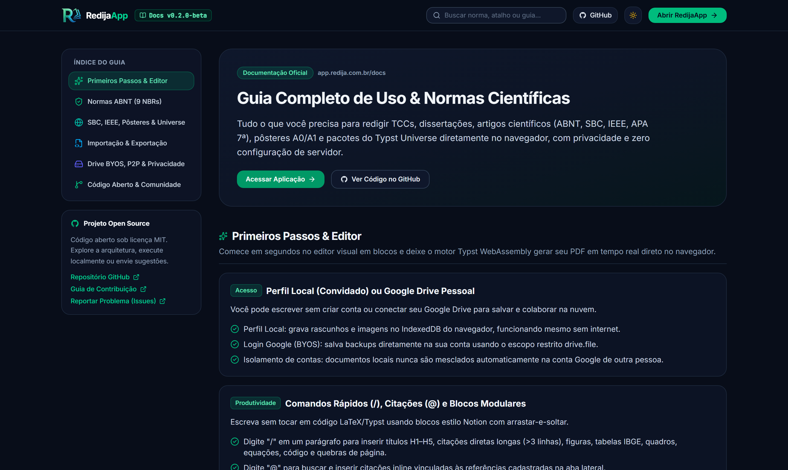

<p align="center">
  <a href="https://app.redija.com.br">
    
  </a>
</p>

<h1 align="center">RedijaApp</h1>

<p align="center">
  <strong>Editor acadêmico visual estilo Notion com compilação científica em tempo real no navegador via Typst WebAssembly.</strong>
</p>

<p align="center">
  <a href="https://app.redija.com.br"><strong>Acessar Aplicação</strong></a> •
  <a href="https://app.redija.com.br/docs"><strong>Documentação</strong></a> •
  <a href="CONTRIBUTING.md"><strong>Contribuir</strong></a> •
  <a href="https://github.com/Candeias-Vinicius/redija-app/issues"><strong>Issues</strong></a>
</p>

<p align="center">
  
  <a href="https://github.com/Candeias-Vinicius/redija-app/actions/workflows/ci.yml"></a>
  
  
  
  <a href="LICENSE"></a>
</p>

---

## Sobre o Projeto

O **RedijaApp** combina uma interface visual em blocos (estilo Notion, baseada em TipTap) com o motor tipográfico **Typst compilado em WebAssembly** executando integralmente no navegador — eliminando a formatação manual frágil do Word e a curva de configuração de servidores LaTeX.

> 📖 **Documentação de Uso e Normas:** Consulte **[app.redija.com.br/docs](https://app.redija.com.br/docs)** para guias detalhados sobre normas ABNT (9 NBRs), SBC, IEEE, APA 7ª Edição, Pôsteres A0/A1, Typst Universe, atalhos `/` e `@`, importadores (`.docx`, `.tex`, `.typ`, `.redija`), Google Drive BYOS e colaboração P2P.

---

## Capturas de Tela

### Editor Visual em Blocos + Compilação Typst WASM em Tempo Real


<details>
<summary>Ver mais telas (Landing Page & Central de Documentação integrada)</summary>

#### Página Inicial (Dark Mode)


#### Central de Documentação (`/docs`)


</details>

---

## Arquitetura & Stack

O projeto adota processamento *local-first* e separação clara entre thread de interface, motor WASM e regras de domínio:

- **Worker WASM Dedicado (`src/core/typst/typst.worker.ts`):** compilador e renderizador Typst operam fora da *main thread*, rasterizando páginas em `OffscreenCanvas` e transferindo `ImageBitmap` *zero-copy* para o preview.
- **Transpilador & Verificadores Plurais (`src/core/transpiler/`):** gera código `.typ` multi-normas e valida regras via estratégias desacopladas (`linters/`).
- **Persistência & Importadores (`src/core/storage/`):** IndexedDB (Dexie.js) com lixeira de 30 dias, sincronização BYOS via Google Drive v3 API, *Auto-Merge* não destrutivo e parsers para `.docx`, `.tex`/`.zip`, `.typ` e `.redija`.
- **Colaboração P2P (`src/core/collaboration/`):** troca de diffs e presença em blocos via WebRTC (PeerJS) e BroadcastChannel, sem banco de dados central.
- **Feedback Serverless (`api/feedback.ts`):** endpoint Vercel compatível com Resend estruturado via injeção de dependência (`EmailProvider`).

| Camada | Tecnologias |
| :--- | :--- |
| **Interface & Editor** | React 19, Tailwind CSS v4, TipTap 3, Lucide Icons |
| **Motor Tipográfico** | Typst WASM (`typst-ts ^0.7.0`: `typst-ts-web-compiler` + `typst-ts-renderer`) |
| **Linguagem & Build** | TypeScript 6.0, Vite 8 |
| **Armazenamento & P2P** | Dexie 4 (IndexedDB), Google Identity Services / Drive API, PeerJS, JSZip, Mammoth |
| **Qualidade & Testes** | ESLint 10 (`--max-warnings 0`), Prettier 3, Vitest 5, Playwright Chromium |

### Estrutura de Diretórios

```text
redija-app/
├── api/                    # Serverless Function Vercel (/api/feedback)
├── docs/                   # Capturas de tela e ativos de documentação do repositório
├── e2e/                    # Testes End-to-End com Playwright
├── public/                 # Logo, favicon, fontes locais (Tinos, Arimo) e CNAME
├── src/
│   ├── components/         # UI React (editor/, sidebar/, customizer/, landing/, docs/)
│   ├── core/               # Lógica de domínio (auth, collaboration, docs, feedback, storage, templates, transpiler, typst, universe)
│   ├── hooks/              # Hooks de estado e orquestração (workspace, undo/redo, drive sync, collab, rota)
│   ├── types/              # Contratos TypeScript de documentos, metadados e normas
│   └── App.tsx             # Orquestrador principal e roteamento
├── .github/workflows/      # CI & Guardrails (ci.yml)
├── vercel.json             # Headers CSP/WASM e rewrite SPA
└── vite.config.ts          # Configuração Vite 8 + worker ES
```

---

## Executando Localmente

### Pré-requisitos

- **Node.js** `20.19+`, `22.12+` ou `24 LTS`
- **npm**

### Instalação e Execução

```bash
git clone https://github.com/Candeias-Vinicius/redija-app.git
cd redija-app
npm install
cp .env.example .env
npm run dev
```

Acesse **`http://localhost:3000`** no navegador.

> **Nota:** Não é necessário configurar credenciais OAuth do Google para desenvolver localmente — na tela inicial, utilize **"Experimentar como Convidado"** ou **"Entrar em Modo Demonstração (Dev)"**.

### Variáveis de Ambiente

| Variável | Obrigatória? | Finalidade |
| :--- | :---: | :--- |
| `VITE_GOOGLE_CLIENT_ID` | Opcional | Client ID OAuth 2.0 (Google Cloud Console) para habilitar login e sync real com Google Drive. |
| `RESEND_API_KEY` | Opcional *(prod)* | Chave do Resend usada pela Vercel Serverless Function em `/api/feedback`. |
| `RESEND_FROM_EMAIL` | Opcional *(prod)* | Remetente configurado no serviço Resend. |
| `RESEND_TO_EMAIL` | Opcional *(prod)* | Caixa de destino para relatos de bug/contato (padrão: `contato.redija@gmail.com`). |

### Scripts Disponíveis

| Comando | Descrição |
| :--- | :--- |
| `npm run dev` | Inicia o servidor de desenvolvimento Vite na porta `3000`. |
| `npm run typecheck` | Executa verificação estrita de tipos (`tsc --noEmit`). |
| `npm run lint` | Roda ESLint exigindo zero warnings (`--max-warnings 0`). |
| `npm test` | Executa todos os testes unitários e compilação WASM via Vitest. |
| `npm run test:e2e` | Executa a suíte End-to-End no Chromium via Playwright. |
| `npm run build` | Valida tipos e gera o bundle de produção em `dist/`. |
| `npm run format` | Formata o código com Prettier. |

---

## CI & Infraestrutura

- **Hospedagem (`https://app.redija.com.br`):** configurada para **Vercel** via [`vercel.json`](vercel.json) (com suporte a rewrites SPA para `/docs`, cabeçalhos CSP/WASM e função serverless `/api/feedback`) e compatível com **Netlify** via [`netlify.toml`](netlify.toml).
- **Pipeline Contínua ([`.github/workflows/ci.yml`](.github/workflows/ci.yml)):** executa `lint`, `typecheck`, `vitest`, `playwright` e `build` em pushes e PRs para `develop` e `main`, além de conter uma trava de segurança que bloqueia Pull Requests para `main` fora da branch `develop`.

---

## Contribuindo

Contribuições são muito bem-vindas! Antes de abrir um Pull Request:

1. Leia o guia completo em **[`CONTRIBUTING.md`](CONTRIBUTING.md)**.
2. Crie sua branch a partir de **`develop`** (PRs diretos para `main` são restritos).
3. Rode `npm run lint`, `npm run typecheck`, `npm test`, `npm run test:e2e` e `npm run build` antes de submeter.

---

## Licença

Distribuído sob a licença **MIT**. Veja [`LICENSE`](LICENSE) para mais detalhes.
