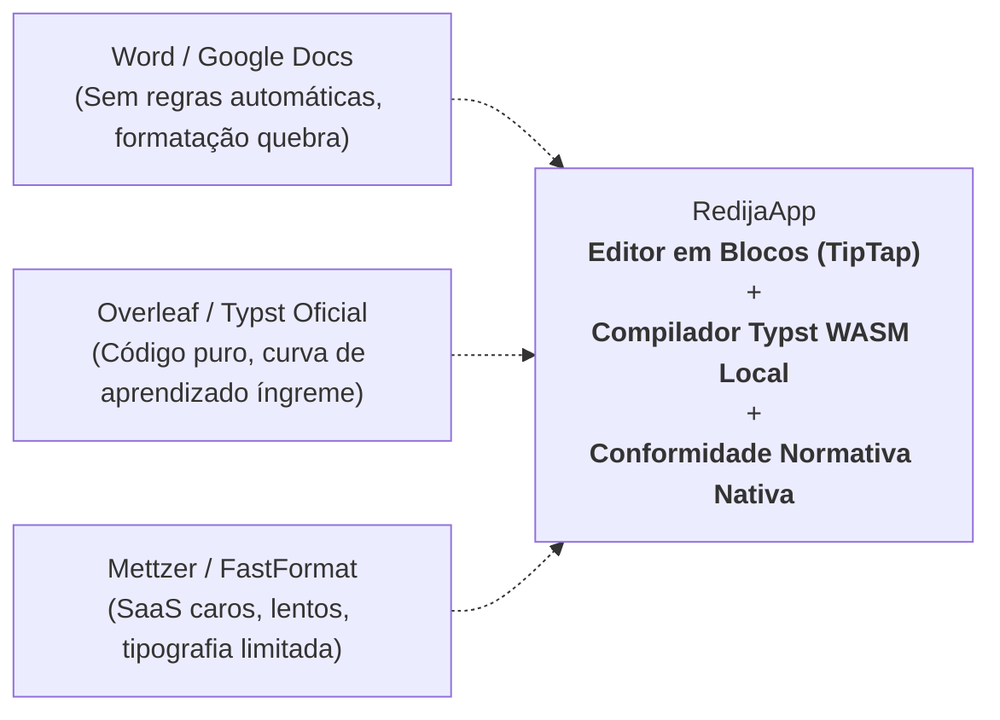

# Análise Estratégica de Mercado & Roadmap de Funcionalidades
## RedijaApp (v0.2.0-beta)

---

## 1. Visão Geral & Proposta Única de Valor (USP)

O **RedijaApp** se posiciona em uma interseção estratégica e diferenciada no ecossistema de escrita acadêmica e científica:



### Principais Pilares do RedijaApp
1. **Curva de Aprendizado Zero:** Interface visual em blocos estilo Notion, acessível a qualquer estudante de graduação sem necessidade de saber comandos de código.
2. **Motor Científico Typst em WebAssembly:** Compilação de PDF com rigor tipográfico de nível internacional, executada diretamente na máquina do usuário (em milissegundos, com custo de servidor praticamente zero).
3. **Privacidade & Local-First (BYOS):** Persistência no navegador via IndexedDB (Dexie) e integração direta com o Google Drive do próprio usuário, sem retenção de dados sensíveis em servidores centrais.
4. **Automação Normativa Profunda:** Suporte nativo a 9 NBRs da ABNT, SBC, IEEE, APA 7ª Edição e Pôsteres Científicos.

---

## 2. Benchmark de Concorrentes

| Player | Pontos Fortes | Pontos Fracos | Oportunidade para o RedijaApp |
| :--- | :--- | :--- | :--- |
| **Mettzer** *(Líder no mercado de TCC no Brasil)* | Foco exclusivo nas normas ABNT; esteira passo a passo de capítulos; interface para o orientador. | Assinatura cara para estudantes; editor lento; não suporta fórmulas matemáticas complexas ou padrões internacionais (IEEE/SBC). | Oferecer a mesma facilidade de uso, porém com compilação instantânea, suporte a fórmulas, privacidade local e custo de entrada muito menor. |
| **Overleaf** *(Referência global em escrita científica)* | Ecossistema maduro; milhares de templates de congressos e periódicos; padrão em Ciências Exatas. | Curva de aprendizado íngreme (LaTeX puro); compilação remota demorada com timeouts frequentes no plano gratuito. | Capturar estudantes e pesquisadores que buscam beleza tipográfica e equações sem a complexidade de debugar erros do TeX. |
| **Typst App Oficial** *(typst.app)* | Compilação ultrarrápida; ecossistema Typst Universe oficial. | Focado exclusivamente em código texto; não possui editor em blocos e não automatiza as peculiaridades das normas brasileiras (ABNT). | Ser a interface visual amigável (WYSIWYG/blocos) e o padrão de escrita acadêmica na América Latina. |
| **FastFormat** | Formatação automática baseada em templates pré-definidos de universidades e congressos. | Editor engessado; pouca flexibilidade de customização visual e layout defasado. | Vencer pela fluidez da edição em blocos e pelo preview reativo em tempo real via Canvas/WASM. |
| **Notion / Craft** | Melhor experiência do mercado em edição de blocos e comandos `/`. | Não gerencia paginação acadêmica, numeração de figuras/tabelas, contagem de páginas para pré-textuais ou referências ABNT. | Trazer a produtividade e estética do Notion para o ambiente acadêmico rigoroso. |

---

## 3. Matriz de Priorização: Impacto vs. Dificuldade

```
       ALTO IMPACTO
            ▲
            │  [A1] Modo Orientador (Revisão & Comentários) [B1] Assistente IA Acadêmico (BYOK/Local)
            │  [A2] Gerador de Slides para Defesa (1-click) [B2] Sincronização Zotero / Mendeley
            │  [A3] Checklist Estrutural de TCC             [B3] Linter de Originalidade / Citações
            │  [A4] Busca Aberta DOI / Crossref / Scholar
            │─────────────────────────────────────────────────────────────
            │  [C1] Contador Acadêmico (Palavras/Páginas)   [D1] Versionamento estilo Git Completo
            │  [C2] Exportação Limpa de Typst (.zip)        [D2] Aplicativo Desktop Nativo
            │  [C3] Templates Prontos por Universidade
            │
            └─────────────────────────────────────────────────────────────► DIFICULDADE
              BAIXA / MÉDIA                                    ALTA
```

---

## 4. Detalhamento das Funcionalidades

### Quadrante A: Alto Impacto & Baixa/Média Dificuldade (Quick Wins Estratégicos)

#### A1. Modo Orientador (Comentários e Notas Marginais)
* **Por que é essencial:** O ciclo de vida do TCC depende da revisão do professor orientador. Se o orientador não puder deixar sugestões pontuais no texto, o aluno é forçado a exportar para `.docx` e abandona o fluxo do RedijaApp.
* **Implementação Técnica:** Utilização de extensões de comentários do TipTap armazenadas como metadados associados ao `blockId` no IndexedDB/P2P.
* **Valor para o cliente:** Viabiliza o uso do aplicativo durante todo o semestre letivo, inclusive nas etapas de banca prévia.

#### A2. Gerador Automático de Slides para a Defesa (1-Click Presentation)
* **Por que é essencial:** Todo aluno que conclui um TCC precisa preparar slides de apresentação para a banca examinadora em menos de 15 dias após a entrega final.
* **Implementação Técnica:** Mapeamento de blocos de títulos (`h1`, `h2`) e tópicos para os pacotes de apresentação do Typst (`touying` ou `polylux`).
* **Valor para o cliente:** Proporciona um momento de grande satisfação ("efeito uau"), entregando o documento e a apresentação formatados com a mesma identidade visual.

#### A3. Checklist Estrutural de TCC & Assistente de Conformidade
* **Por que é essencial:** O maior receio de quem escreve uma monografia é esquecer componentes essenciais exigidos pela NBR 14724 ou pela banca (ex: folha de aprovação, resumo em língua estrangeira, dedicatória, conclusão).
* **Implementação Técnica:** Painel lateral dinâmico que analisa a árvore de blocos e metadados, exibindo uma barra de progresso e lembretes normativos.
* **Valor para o cliente:** Segurança psicológica contra reprovações formais na entrega do trabalho.

#### A4. Busca Direta de Referências por DOI / Crossref / OpenAlex
* **Por que é essencial:** Reduz o atrito de cadastrar manualmente autores, título, revista, volume e ano de publicações.
* **Implementação Técnica:** Integração com APIs abertas e gratuitas (Crossref API e OpenAlex API), preenchendo automaticamente o modal de referências existente.
* **Valor para o cliente:** Cadastrar referências bibliográficas completas em poucos segundos apenas colando o DOI ou digitando o título.

---

### Quadrante B: Alto Impacto & Alta Dificuldade (Diferenciais Competitivos)

#### B1. Assistente de Escrita Acadêmica com IA (Privacidade & BYOK)
* **Por que é essencial:** Alunos enfrentam bloqueios frequentes na hora de transformar ideias em linguagem científica culta (voz passiva, coesão, conectivos acadêmicos).
* **Implementação Técnica:** Suporte a BYOK (*Bring Your Own Key*) para Gemini API ou OpenAI, com prompts calibrados para redação científica, ou execução de modelos leves locais no navegador via WebLLM.
* **Diferencial:** Não cobra mensalidades exorbitantes de IA e garante privacidade acadêmica sem vazar a pesquisa para servidores de terceiros.

#### B2. Sincronização com Zotero e Mendeley
* **Por que é essencial:** Pesquisadores de pós-graduação (Mestrado e Doutorado) já possuem centenas de referências catalogadas nesses softwares.
* **Implementação Técnica:** Leitura de arquivos `.bib` vinculados ou sincronização via API do Zotero / WebDAV.
* **Valor para o cliente:** Permite a transição imediata de pós-graduandos para o RedijaApp sem perda de histórico.

#### B3. Linter de Citações e Alerta de Paráfrases
* **Por que é essencial:** O receio de plágio acidental em citações indiretas é a maior dor de cabeça de estudantes e comitês de ética.
* **Implementação Técnica:** Algoritmo heurístico que detecta parágrafos com afirmações factuais longas sem referências associadas (`@`), sugerindo inclusão de fonte.
* **Valor para o cliente:** Prevenção ativa contra erros metodológicos antes do envio para a banca.

---

### Quadrante C: Médio Impacto & Baixa Dificuldade (Melhorias de Usabilidade)

#### C1. Contador Métrico com Alertas Normativos
* Contagem contínua de páginas, palavras e caracteres.
* Alerta automático sobre o tamanho do resumo conforme a NBR 6028 (150 a 500 palavras para trabalhos acadêmicos; 100 a 250 para artigos).

#### C2. Templates Oficiais Pré-Configurados de Universidades Brasileiras
* Modelos pré-ajustados com capas, brasões e normas de formatação específicas das principais instituições (USP, UNICAMP, UFMG, UFRJ, IFs, PUC, etc.).

#### C3. Exportação de Pacote Typst Limpo (.zip)
* Exportação em um clique de todos os arquivos (`.typ`, imagens e referências `.bib`), facilitando submissões em conferências que já aceitam Typst nativamente.

---

### Quadrante D: Menor Prioridade Imediata (O que evitar por enquanto)

* **Editor LaTeX Puro Concorrente:** Dividiria o foco do produto e aumentaria a complexidade de manutenção, disputando diretamente contra o Overleaf.
* **Aplicativo Mobile Dedicado:** Pouca adesão real para redação de artigos longos; otimizar para Desktop e Tablets é suficiente.
* **Infraestrutura de Banco de Dados Próprio:** Comprometeria o modelo *local-first*, elevando custos de servidores e levantando questões regulatórias de proteção de dados (LGPD).

---

## 5. Proposta de Roadmap de Execução

```mermaid
flowchart TD
    subgraph Fase 1 ["Fase 1: Quick Wins & Retenção (1 a 2 Meses)"]
        F1A["Checklist Estrutural de TCC & ABNT"]
        F1B["Contador Acadêmico com Regras NBR 6028"]
        F1C["Busca de Referências via Crossref / OpenAlex"]
    end

    subgraph Fase 2 ["Fase 2: Fechamento de Ciclo (2 a 3 Meses)"]
        F2A["Modo Orientador: Comentários e Revisões"]
        F2B["Gerador Automático de Slides para a Defesa"]
        F2C["Templates das Maiores Universidades do País"]
    end

    subgraph Fase 3 ["Fase 3: Diferenciação & Escala (3 a 5 Meses)"]
        F3A["Assistente de Escrita Acadêmica (IA com BYOK)"]
        F3B["Integração e Importação com Zotero"]
        F3C["Linter de Citações / Verificador de Fontes"]
    end

    Fase 1 --> Fase 2 --> Fase 3
```

---
*Documento elaborado para direcionamento de produto e engenharia do RedijaApp.*
