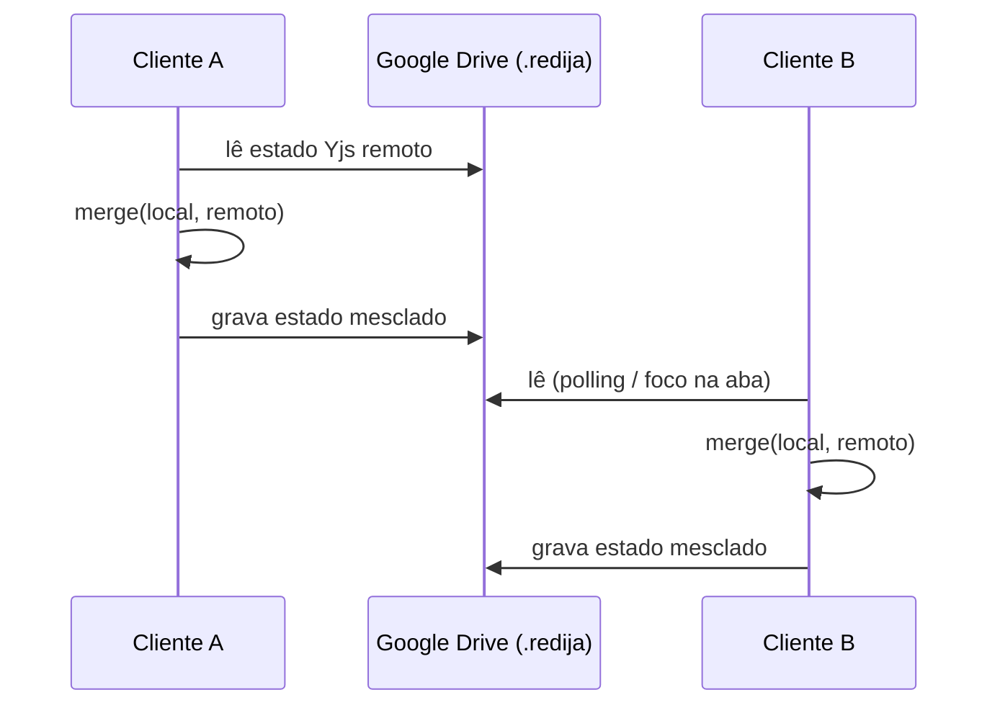
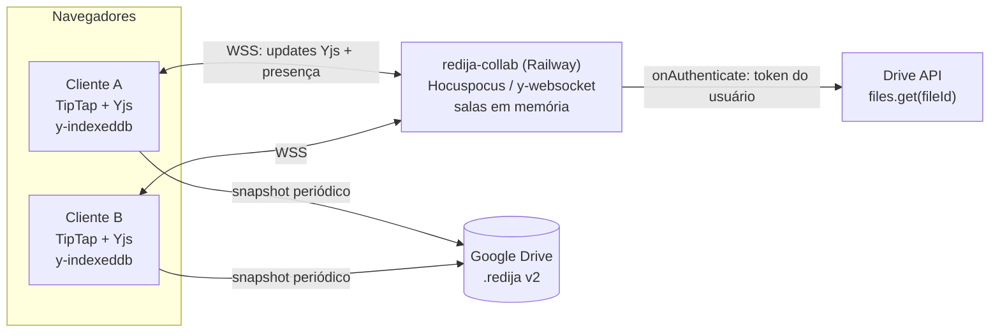

# Arquitetura de Compartilhamento & Colaboração em Tempo Real
## RedijaApp (v0.2.0-beta) · Proposta técnica

> Status: **proposta**, ainda sem implementação. Base analisada: `develop` @ `a24ff9d`.

---

## 1. Contexto

Hoje o RedijaApp tem duas peças que tentam resolver a colaboração:

| Peça | Arquivos | Objetivo |
| :--- | :--- | :--- |
| **Compartilhamento via Drive** | `src/components/ShareModal.tsx`, `src/core/storage/googleDriveService.ts` (`inviteCollaborator`, `listCollaborators`, `removeCollaborator`), `src/hooks/useDriveSyncOrchestrator.ts` | Dar acesso de edição a outra conta Google e sincronizar o `.redija` |
| **Tempo real P2P** | `src/core/collaboration/RealtimeCollabManager.ts`, `src/hooks/useRealtimeCollab.ts` | Edição simultânea e presença via PeerJS (WebRTC) + `BroadcastChannel` |

São **duas features distintas**, mas dependentes:

- **Compartilhamento (assíncrono):** *quem* pode abrir e editar e *onde* o documento persiste.
- **Colaboração em tempo real (síncrono):** *como* as edições de várias pessoas se juntam enquanto estão abertas ao mesmo tempo.

O tempo real precisa do compartilhamento para saber quem pode entrar na sala. O compartilhamento precisa de uma estratégia de mesclagem para não perder edições.

Com a chegada do backend no Railway (hoje só o serviço `redija-import`, em `server/`), passa a ser viável uma solução no modelo do Word e do Google Docs: um servidor central de sincronização.

---

## 2. Diagnóstico: por que a feature atual não funciona

### 2.1 Compartilhamento via Drive

| # | Problema | Onde | Efeito |
| :-: | :--- | :--- | :--- |
| 1 | Escopo OAuth `drive.file`: o app só vê arquivos que **ele criou** ou que o usuário **abriu por ele** (Picker / "Abrir com"). | `src/core/auth/GoogleAuthContext.tsx:9` | O convidado recebe o e-mail do Drive, mas `listDriveProjects` (`googleDriveService.ts:567`) nunca retorna o arquivo. **O projeto não aparece no Redija do convidado.** |
| 2 | O salvamento faz `PATCH ...?addParents={pastaDoUsuário}` em qualquer arquivo. | `googleDriveService.ts:320` (e `:468` no PDF) | Num arquivo de outra pessoa, adicionar um segundo pai falha. Como o erro não é 404, o salvamento lança uma exceção. **O convidado não consegue salvar.** |
| 3 | Projetos baixados do Drive recebem `ownerEmail = user.email`. | `useDriveSyncOrchestrator.ts:252, 272, 279` | Perde-se a noção de "arquivo compartilhado comigo". O app trata o arquivo como próprio e tenta movê-lo (ver #2). |
| 4 | Mesclagem entre **duas** versões, sem a versão de origem. | `src/core/storage/projectMerger.ts` | Não distingue "apagado aqui" de "criado lá". Quando os dois editam o mesmo bloco, um vence pelo horário ou o app cria um **parágrafo duplicado** (`projectMerger.ts:99`). |
| 5 | Gravação do arquivo inteiro com "último a escrever vence". | `saveProjectToDrive` | Duas gravações próximas: a segunda apaga a primeira. |

### 2.2 Tempo real P2P (PeerJS)

| # | Problema | Onde | Efeito |
| :-: | :--- | :--- | :--- |
| 6 | Sinalização pelo **servidor público gratuito do PeerJS** (`0.peerjs.com`). | `RealtimeCollabManager.ts:250` | Sem garantia de disponibilidade e com limite de uso. |
| 7 | Só **STUN**, sem **TURN**. | `RealtimeCollabManager.ts:254-255` | Em redes de universidade, 4G e NAT corporativo/simétrico a conexão não fecha. |
| 8 | IDs de sala previsíveis (`redija_{fileId}_s{0..4}`), **sem autenticação**. | `RealtimeCollabManager.ts:247` | Quem conhece o `fileId` entra na sala e recebe o conteúdo do documento. |
| 9 | Envia o bloco inteiro (`block_update`) ou o documento inteiro (`blocks_sync`) com "último vence". | `RealtimeCollabManager.ts`, `useRealtimeCollab.ts` | Duas pessoas no mesmo bloco sobrescrevem uma à outra e o cursor "pula". |
| 10 | Rede em malha com no máximo 5 slots, sem persistência. | `MAX_SLOTS = 5` | Escala limitada. O documento "vivo" só existe enquanto alguém está online. |

**Causa comum:** o documento é um JSON de blocos com `content` em HTML. Não existe uma representação de documento que saiba juntar edições concorrentes. Trocar o transporte (Drive, P2P ou servidor) sem mudar isso continua perdendo texto.

---

## 3. Fundação comum: documento como CRDT (Yjs)

Qualquer opção da seção 4 depende desta mudança.

**Yjs** é um CRDT (*Conflict-free Replicated Data Type*): duas cópias do documento editadas de forma independente **sempre** se juntam no mesmo resultado, sem perder nada e em qualquer ordem. É a base da maioria dos editores colaborativos modernos e tem integração oficial com o TipTap (`@tiptap/extension-collaboration`, via `y-prosemirror`).

### 3.1 Modelo proposto

```
Y.Doc (por projeto)
├── meta        : Y.Map          → DocumentMetadata (título, autores, instituição…)
├── config      : Y.Map          → template, sidebarConfig, customizações
├── blockOrder  : Y.Array<string>→ ordem dos blocos (ids)
├── blocks      : Y.Map<id, Y.Map>
│     ├── type  : string
│     ├── meta  : Y.Map           → nível do título, legenda, dados de tabela…
│     └── body  : Y.XmlFragment   → conteúdo rico (TipTap Collaboration)
└── references  : Y.Map<id, Y.Map>→ AcademicReference
```

- Cada bloco de texto rico ganha seu próprio `Y.XmlFragment`, ligado ao editor TipTap do bloco (`RichTextInput.tsx`).
- Blocos não textuais (tabela, imagem, equação, código) usam `Y.Map` / `Y.Text`.
- O transpilador Typst continua recebendo um `DocumentProject`, gerado a partir do `Y.Doc` por uma função `yDocToProject()`. Assim, `typstGenerator`, os linters e o exportador não mudam.
- Persistência local: `y-indexeddb`, ou atualizações Yjs gravadas no Dexie, que já existe.
- Desfazer/refazer: `Y.UndoManager` substitui `useUndoRedoHistory`, porque o histórico atual por *snapshot* desfaria edições dos colegas.

### 3.2 Migração

- `schemaNormalizer` ganha `projectToYDoc()`. Um `.redija` v1 (JSON) é convertido ao abrir, uma única vez.
- Novo formato `.redija` v2: `{ version: 2, yjsState: base64, snapshot: DocumentProject }`. O `snapshot` mantém o arquivo legível e permite importar em versões antigas ou ferramentas externas.

---

## 4. Opções de arquitetura

### Opção A: só Google Drive (assíncrono)

O Drive é o meio de troca. Cada cliente lê a versão remota, junta com a local (Yjs) e grava.



**O que muda para funcionar:**
1. **Manter `drive.file`.** O escopo `drive` completo é *restrito* e exige auditoria de segurança anual paga (CASA) e verificação do app pelo Google.
2. **Google Picker** para o convidado: ele escolhe o arquivo compartilhado uma vez e o Google libera aquele arquivo para o app. O link do convite (`/abrir?file={id}`) abre o Picker já apontando para o arquivo (`setFileIds`).
3. Opcional: registrar o app no **"Abrir com"** do Drive (Drive UI Integration). Clicar no `.redija` dentro do Drive abre o Redija e libera o arquivo.
4. **Não mover arquivos alheios:** só usar `addParents` quando `ownedByMe === true`. Guardar `isSharedWithMe` e o dono real em vez de sobrescrever `ownerEmail`.
5. Ler `capabilities.canEdit`: papel `reader` abre em modo somente leitura e nunca grava.
6. **Salvar juntando versões:** antes de gravar, comparar `headRevisionId`. Se mudou, baixar, fazer `Y.applyUpdate` e gravar. Se duas gravações se cruzarem, a próxima rodada de sync recupera o que faltou: como o merge Yjs é idempotente, nada se perde.

| Prós | Contras |
| :--- | :--- |
| Custo zero, sem servidor novo | **Não é tempo real:** atraso de segundos a minutos |
| Mantém o "seus arquivos no seu Drive" | Polling (o `changes.watch` do Drive exige webhook público) |
| Permissões e notificações nativas do Google | Sem presença nem cursores |

### Opção B: P2P (WebRTC), corrigindo a atual

Yjs + `y-webrtc` (ou o PeerJS atual), com sinalização e TURN próprios.

| Prós | Contras |
| :--- | :--- |
| Latência baixa entre quem está conectado | Precisa de **TURN próprio** (custo de banda) para ser confiável |
| O conteúdo não passa por servidor | Autenticar a sala exige um servidor de sinalização com autorização, ou seja, backend do mesmo jeito |
| | Rede em malha não escala (~5 pessoas) |
| | O documento só "vive" com alguém online; continua precisando da opção A para persistir |

**Avaliação:** o P2P só fazia sentido para ter "custo zero de servidor". Com backend disponível, ele mantém os problemas de rede e segurança e **não elimina** a necessidade de servidor (sinalização + TURN). **Não recomendado.**

### Opção C: servidor de sincronização (modelo Word / Google Docs)

Um serviço WebSocket no Railway repassa as atualizações Yjs entre os clientes da mesma sala. O Word (co-autoria do Office) e o Google Docs usam esse padrão de servidor central; a versão moderna troca OT por CRDT.



**Autorização delegada ao Drive** (sem sistema de permissões próprio):
1. O cliente abre `wss://collab.redija.com.br/{fileId}` e envia o token OAuth.
2. O servidor chama `GET drive/v3/files/{fileId}?fields=id,capabilities(canEdit)` **com o token do próprio usuário**.
3. Se `200`, a pessoa entra. Se `canEdit === false`, a conexão fica somente leitura. Se `403/404`, a conexão é recusada.
4. A revalidação acontece a cada reconexão. Revogar o acesso no `ShareModal` tira a pessoa na reconexão seguinte; dá para forçar com um evento para o servidor.

**Persistência: Drive como "arquivo oficial", servidor sem banco.**
- O servidor guarda as salas **só em memória**. Não grava o conteúdo dos documentos em banco, o que reduz a exposição de dados pessoais (LGPD) e o custo.
- Cada cliente com permissão de edição grava o estado no Drive periodicamente (ex.: a cada 30 s de inatividade e ao fechar), usando o fluxo da Opção A. Na prática, a **Opção A vira o "modo offline" da Opção C**.
- Se o servidor reiniciar, os clientes reconectam e reenviam seu estado local (protocolo de sync do Yjs), e a sala se recompõe sozinha.
- Evolução opcional: a extensão de banco do Hocuspocus (Postgres/Redis) para histórico de versões. Isso exige revisar a política de privacidade.

**Operação no Railway:**
- Serviço **separado** do `redija-import`: o Pandoc tem picos de memória, e o serviço de colaboração precisa de conexões longas.
- `sleepApplication: false` (WebSocket não pode dormir).
- Uma instância de início. Para escalar horizontalmente: sessão fixa por `fileId` ou a extensão Redis do Hocuspocus.
- Atualizar a CSP (`vercel.json`, `netlify.toml`): adicionar `wss://collab.redija.com.br` (e `-dev`) e remover `*.peerjs.com`.

| Prós | Contras |
| :--- | :--- |
| Edição simultânea real, presença e cursores | Novo serviço para operar (~US$ 5–10/mês) |
| WebSocket comum: funciona em qualquer rede | O conteúdo trafega pelo servidor (em memória, via TLS) |
| Segurança via permissões do Drive | Depende do refactor para Yjs (seção 3) |
| Escala além de 5 pessoas | |

---

## 5. Comparativo

| Critério | A. Só Drive | B. P2P | C. Servidor |
| :--- | :-: | :-: | :-: |
| Edição simultânea | ❌ | ✅ | ✅ |
| Funciona sem ninguém online | ✅ | ❌ | ✅ |
| Confiabilidade de rede | ✅ | ⚠️ sem TURN | ✅ |
| Autorização | ✅ Drive | ❌ / exige servidor | ✅ Drive |
| Presença / cursores | ❌ | ✅ | ✅ |
| Custo mensal | 0 | 0 – TURN | ~US$ 5–10 |
| Complexidade operacional | Baixa | Média | Média |
| Depende de Yjs | Sim | Sim | Sim |

---

## 6. Recomendação e roadmap

**Decisão:** abandonar o P2P e adotar **Yjs + Drive (A) como base**, com o **servidor de sincronização (C)** por cima para o tempo real.

### Fase 1: fundação + compartilhamento que funciona
- [ ] Modelo `Y.Doc` (seção 3.1), `projectToYDoc` / `yDocToProject`, `.redija` v2 e migração da v1
- [ ] TipTap `Collaboration` em cada bloco de texto rico e `Y.UndoManager`
- [ ] Persistência local do estado Yjs (Dexie / `y-indexeddb`)
- [ ] Salvar no Drive juntando versões (`headRevisionId` + `Y.applyUpdate`)
- [ ] Google Picker + link de convite `/abrir?file={id}`
- [ ] Corrigir `addParents` (só em arquivo próprio) e preservar `isSharedWithMe` / dono real
- [ ] Modo somente leitura via `capabilities.canEdit`
- [ ] Remover `projectMerger` do fluxo de sync (substituído pelo merge Yjs)

**Entrega:** convidar alguém e os dois editarem o mesmo trabalho sem perder texto, sem servidor novo.

### Fase 2: tempo real
- [ ] Serviço `redija-collab` (Hocuspocus) em `server-collab/` + entrada em `.railway/railway.ts`
- [ ] `onAuthenticate` com validação no Drive (seção 4, Opção C)
- [ ] Provider no front (`@hocuspocus/provider`), *awareness* para presença e cursores (substitui `RealtimeCollabManager`)
- [ ] Remover `peerjs` das dependências e da CSP; adicionar o domínio `wss://`
- [ ] Indicadores no `Header` / `Editor` a partir do *awareness*

**Entrega:** edição simultânea, presença e cursores, em qualquer rede.

### Fase 3: opcional, recursos de revisão
- [ ] Comentários ancorados em trechos (marcas relativas do Yjs)
- [ ] Histórico de versões (snapshots Yjs ou `revisions` do Drive)
- [ ] Modo sugestão / "controlar alterações" para orientadores

---

## 7. Riscos e pontos em aberto

| Risco | Mitigação |
| :--- | :--- |
| Refactor do editor para Yjs é grande e toca no núcleo | Migrar por trás de uma *feature flag*; `yDocToProject` mantém transpilador, linters e exportador intactos |
| Arquivo `.redija` v2 cresce com o histórico Yjs | Compactar periodicamente (`Y.encodeStateAsUpdate` de um doc novo) e gravar o snapshot sem histórico de exclusões |
| Imagens grandes dentro do Y.Doc | Manter imagens como arquivos separados no Drive e guardar só a referência no Y.Doc (alinhado a `imageQuota.ts`) |
| Token OAuth expira (1 h) com a conexão WS aberta | Validar só no handshake; o cliente reconecta com token novo ao renovar |
| Convidado sem conta Google | Fora do escopo: o Drive exige conta Google para `type: user` |
| Conteúdo trafegando pelo servidor (LGPD) | Salas só em memória, sem logs de conteúdo, TLS; registrar na política de privacidade |
| Sinalização P2P antiga ainda em uso durante a transição | Remover o PeerJS na mesma entrega da Fase 2 |
